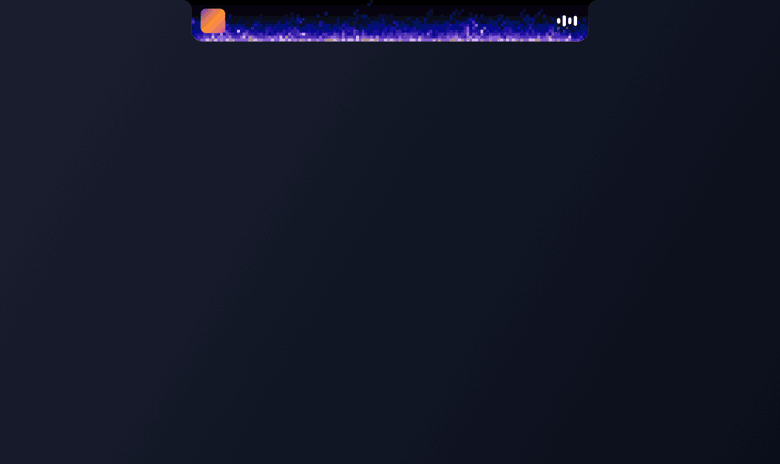
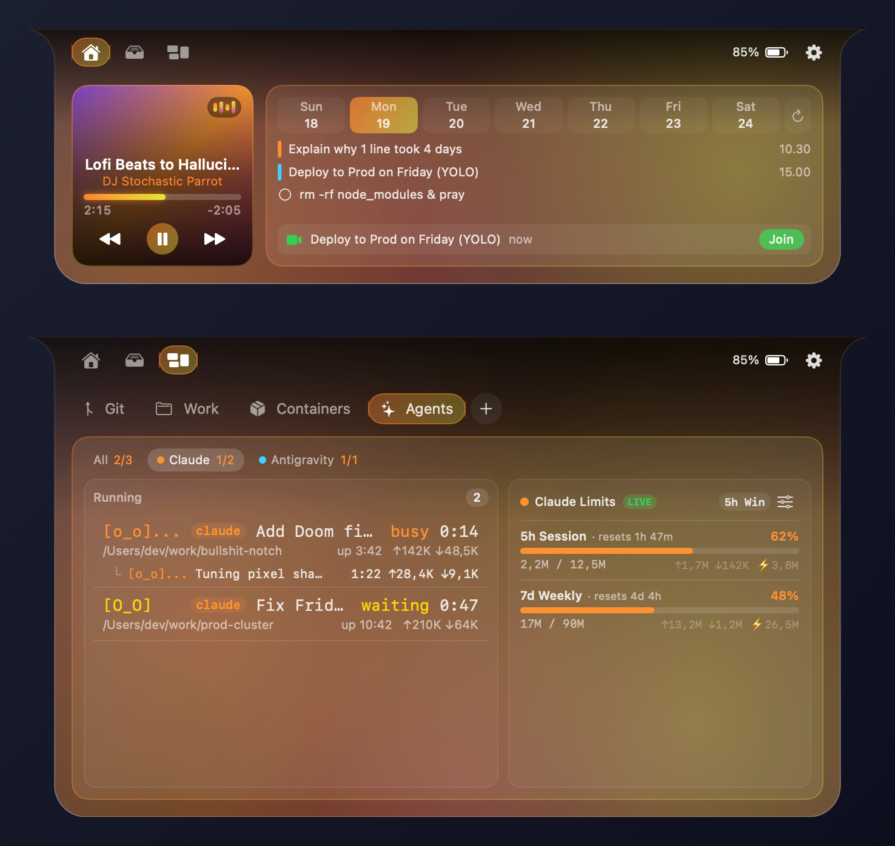

# 🔥 BullshitNotch

[](https://www.apple.com/macos/)
[](https://swift.org)
[](desktop/)
[](#)
[](LICENSE)

> **Apple gave you a black rectangle at the top of your screen. We stuffed our entire workflow, 4 coding agents, Docker containers, Spotify, and PS1 Doom Fire inside it.**



<details>
<summary>📸 View Full High-Res Static Screenshot</summary>



</details>

---

## 🤨 What is this?

**BullshitNotch** turns your MacBook notch into an absurdly over-qualified command center that stays **one constant size** when closed, lights itself on fire when your AI agents are cooking, and expands on hover into everything you actually use:

- 🔥 **8 Ridiculous Notch Animations**: **Doom Fire**, **KITT Scanner**, **Tesla Lightning**, **Cyberpunk Plasma**, **Matrix Rain**, **RGB Rave**, **Hyperspace Warp**, or **Random Bullshit Go** (all of them at once).
- 🤖 **AI Agent Mission Control**: Live sessions & subagent trees for **Claude Code**, **Antigravity**, **Cursor**, and **Command Code**, plus **5-hour session** & **7-day weekly** quota bars. Claude and Command Code can show a `LIVE` badge, Cursor counts requests instead of tokens, and cache-weighted math keeps cached turns from fake-inflating usage. Turn any harness off in **Settings → Activities**.
- 🚀 **Work Project Runner**: Drop your repo folders in, start/stop dev servers with live logs, pop open **Terminal / iTerm**, or launch your project straight into `claude`, `agy`, `codex`, `opencode`, or `aider`.
- 🐳 **Containers**: Start, stop, tail logs, or shell into **Docker / OrbStack / Podman** containers without touching a terminal.
- 🎵 **Music + Ambient Aurora**: Spotify & Apple Music controls with a breathing multi-color aurora bled from the album art.
- 📅 **Calendar, Reminders, Mirror & Shelf**: Join your next meeting, check off tasks, check your face before a call, or drag-and-drop files into the floating Shelf + AirDrop.

---

## ⚡ Install

### One-Liner (Builds & Installs to `/Applications`)
```bash
curl -fsSL https://raw.githubusercontent.com/ansxy/bullshit-notch/main/install.sh | bash
```

### Or Download the `.dmg`
Grab **`BullshitNotch.dmg`** from [Releases](https://github.com/ansxy/bullshit-notch/releases), drag `BullshitNotch.app` to **Applications**, and if macOS Gatekeeper complains because we didn't pay Tim Cook $99/yr:
```bash
xattr -cr /Applications/BullshitNotch.app && open /Applications/BullshitNotch.app
```

---

## 🛠️ Build It Yourself

Zero third-party packages. Pure Swift + AppKit/SwiftUI:

```bash
git clone https://github.com/ansxy/bullshit-notch.git
cd bullshit-notch
./build.sh      # Build & launch BullshitNotch.app
./package.sh    # Build universal dist/BullshitNotch.dmg & BullshitNotch.zip
```

## 🖥️ No MacBook Notch? Fine.

Windows and Linux get the same top-of-screen panel from `desktop/` (Rust + egui). On Linux it wants **X11 or XWayland** so the hover shape can click through.

```bash
cargo run --manifest-path desktop/Cargo.toml
cargo run --manifest-path desktop/Cargo.toml -- --demo          # fake sessions, no live files
cargo run --manifest-path desktop/Cargo.toml -- --demo --open   # pin the panel open
```

Package it:

```bash
bash desktop/package-linux.sh     # dist/bullshit-notch-linux-x86_64.tar.gz
./desktop/package-windows.ps1     # dist/bullshit-notch-windows-x86_64.zip
```

A `desktop-v*` tag builds those archives on GitHub Actions.

## 🗑️ Uninstall

```bash
./uninstall.sh
```

---

## 🙌 Credits & Inspiration

Inspired by and built on the dynamic notch concept from [**boring.notch**](https://github.com/TheBoredTeam/boring.notch) — taken off the rails with multi-agent harnesses, token quota tracking, project & container runners, and 8 absurd notch animations.

## 📄 License

MIT — [LICENSE](LICENSE). Random bullshit go. 🌙
