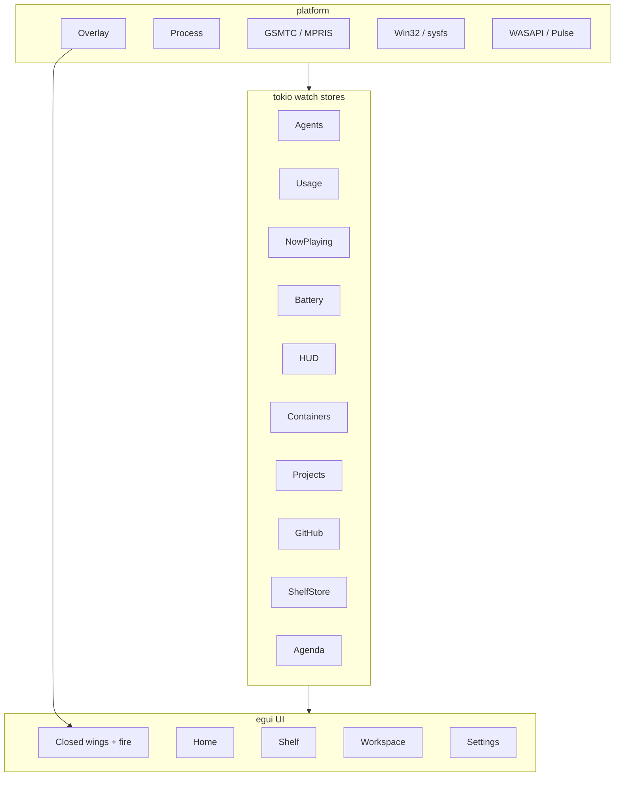

# Desktop (Windows + Linux) Full Implementation Plan

**Base:** current `feat/desktop-win-linux-mvp` MVP (`desktop/` egui+wgpu, Claude agents fire, hover open, X11/Win32 overlay). Spec: [docs/superpowers/specs/2026-10-20-windows-rust-port-design.md](docs/superpowers/specs/2026-10-20-windows-rust-port-design.md) + Linux section. Original task list: [docs/superpowers/plans/2026-10-20-windows-rust-port.md](docs/superpowers/plans/2026-10-20-windows-rust-port.md).

**Defaults locked in:** keep crate path `desktop/`; force X11/XWayland on Linux (no Wayland layer-shell yet); skip macOS-only QA recorder; one feature branch + PR per phase below; commit outstanding MVP polish first.

## Already done (MVP)

- [desktop/Cargo.toml](desktop/Cargo.toml), [config.rs](desktop/src/config.rs), [shape.rs](desktop/src/shape.rs), [fire.rs](desktop/src/fire.rs)
- Overlay: [platform/win32.rs](desktop/src/platform/win32.rs), [platform/x11.rs](desktop/src/platform/x11.rs) + leave/reopen gate
- [stores/agents.rs](desktop/src/stores/agents.rs) (Claude only)
- [app.rs](desktop/src/app.rs) + [ui/mod.rs](desktop/src/ui/mod.rs) closed fire (shape-clipped mesh) + Agents list

## Target architecture

## Phase 0 — Land MVP polish

- Commit uncommitted hover/fire/layout fixes on `feat/desktop-win-linux-mvp` (or squash into follow-up commit).
- Open PR to `main` so full work stacks cleanly.
- Save this plan as `docs/superpowers/plans/2026-10-25-desktop-win-linux-full.md`.

## Phase 1 — Closed-wing activity chrome + palette

**Branch:** `feat/desktop-palette-wings`

- Add [desktop/src/palette.rs](desktop/src/palette.rs): 16×16 vibrancy extract + `seed_for_key` + `downscale_image_rgba` (≤240) from macOS `NowPlaying.swift`.
- Extend closed UI: left/right wings, activity priority **HUD > charger > music > agents** (match [Sources/Notch.swift](Sources/Notch.swift) `activity`).
- Fire stays shape-clipped mesh backdrop; artwork / visualizer / battery bolt / HUD bar in wings (demo.gif layout).
- Tests: palette extract + seed determinism (original plan Task 3).

## Phase 2 — Platform live stores (NowPlaying, Battery, HUD)

**Branch:** `feat/desktop-live-stores`

| Store | Windows | Linux |
|-------|---------|-------|
| `stores/now_playing.rs` | WinRT GSMTC | MPRIS D-Bus (`zbus`) |
| `stores/battery.rs` | `GetSystemPowerStatus` + power broadcast | `/sys/class/power_supply` or UPower |
| `stores/hud.rs` | WASAPI + media keys; brightness via WMI/Dxva2 where available | Pulse/PipeWire volume; brightness via `brightnessctl`/sysfs |

- Shared snapshots over `watch`; `--demo` presets.
- Wire into activity priority + Home music card later.
- Tests: battery `just_changed` 3s, media elapsed math, hit-test helpers already exist.

## Phase 3 — Agents complete: Antigravity + UsageTracker

**Branch:** `feat/desktop-agents-usage`

- Extend agents store for Antigravity paths (`~/.gemini/antigravity*`).
- Add [desktop/src/stores/usage.rs](desktop/src/stores/usage.rs): 5h/Daily/7d, `UsageFileCache` keyed by `(PathBuf, mtime, size)`, optional Anthropic OAuth `/usage`.
- UI: filter pills All/Claude/Antigravity + `HarnessLimitsCard`.
- Tests: partial-line jsonl (already), usage cache + cache-read weighting.

## Phase 4 — Shelf + Agenda + Home tab

**Branch:** `feat/desktop-home-shelf`

- `stores/shelf.rs`, `stores/agenda.rs` (meeting URL detector; local tasks / `.ics` best-effort on Linux).
- UI modules: [ui/home.rs](desktop/src/ui/home.rs), [ui/shelf.rs](desktop/src/ui/shelf.rs); tab pills Home / Shelf / Workspace.
- Dropped files via egui; reveal in Explorer/`xdg-open` parent.

## Phase 5 — Workspace: Git, Work, Containers

**Branch:** `feat/desktop-workspace`

- `stores/github.rs` (`gh search prs` via `run_hidden`).
- `stores/work.rs` (script detect, log ring, `kill_process_tree`, terminal launch: wt/PowerShell/WezTerm on Win; gnome-terminal/kitty/wezterm/`xdg-open` on Linux).
- `stores/containers.rs` (docker/podman; WSL2 Windows-only).
- [ui/workspace.rs](desktop/src/ui/workspace.rs): section pills + custom shortcuts.
- Tests: docker NDJSON/ports, `detect_default_service_command`, meeting links.

## Phase 6 — Settings + tray + polish

**Branch:** `feat/desktop-settings-tray`

- [ui/settings.rs](desktop/src/ui/settings.rs): 6 tabs (Notch, Theme, Activities, Tabs, Menus, System) bound to `Prefs`.
- `tray-icon` → Settings / Quit (Win + Linux).
- Persist prefs on change; keyboard focus only for `TextEdit` (existing overlay `wants_keyboard` path).

## Phase 7 — Release packaging

**Branch:** `feat/desktop-ci`

- `[profile.release]` already in Cargo.toml; add `.github/workflows/release-desktop.yml` for `x86_64-pc-windows-msvc` + `x86_64-unknown-linux-gnu`.
- `desktop/package-windows.ps1` + simple Linux tarball script.
- Smoke: `cargo test --manifest-path desktop/Cargo.toml`; Windows cross-check via `cargo check --target x86_64-pc-windows-msvc`.

## Global constraints (carry forward)

- Memory &lt;35 MB idle; no 60 FPS when closed idle; fire wall-clock 80ms; wake thread only while open/burning.
- All Windows child processes: `CREATE_NO_WINDOW`.
- Click-through outside shape; full-window input only while open (current leave fix).
- `graphify update .` after each phase; use toolchain `cargo` path if rustup proxy broken in agent shell.

## Non-goals this plan

- Native Wayland layer-shell (ponytail upgrade).
- QA recorder / Screen Recording.
- Feature-complete Outlook/Windows Calendar parity (agenda is local/.ics + URL detect first).
